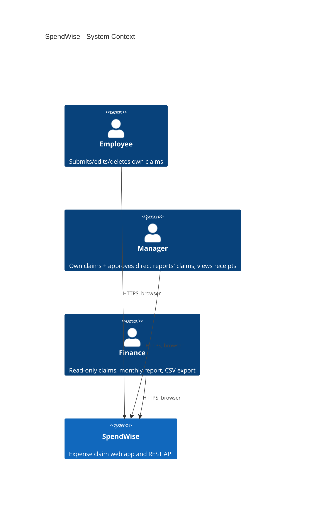
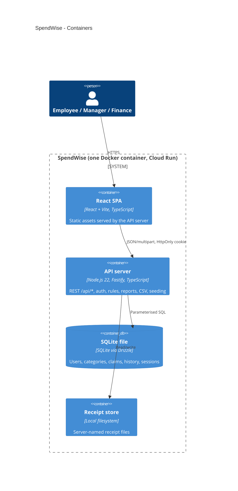

# SpendWise Architecture Proposal (docs BRD/SRS/SFS v1.1, Approved)

## 1. C4 Context (Level 1)



No external integrations in v1 (no payroll, HR, SSO, email).

## 2. C4 Container (Level 2)



## 3. Technology choices (ADR one-liners)

| Choice | Justification |
| --- | --- |
| TypeScript, Node.js 22 | Mandated by project settings; one language across the stack. |
| Fastify | Allowed by settings; schema validation at every boundary, fast, small. |
| React + Vite, served by same container | Mandated; satisfies the one-container constraint. |
| SQLite + Drizzle | Mandated; NFR-09 demo storage, and Drizzle's dialect abstraction permits a later PostgreSQL switch. |
| Drizzle repository layer behind interfaces | Keeps the DB swap (NFR-09) isolated and queries parameterised. |
| Server-side sessions (random ID in HttpOnly SameSite=Lax cookie, Secure over HTTPS) | Supports 30-min idle expiry and logout invalidation (FR-01, NFR-03). |
| argon2id (cost per NFR-03) | Allowed hashing choice, stronger than bcrypt. |
| Money as integer paise, rendered as 2-decimal string | Avoids float error; API money is a string (SRS section 5). |
| Zod (or Fastify JSON schema) | Boundary validation producing the specified field codes. |
| Vitest / Playwright / k6 | Mandated test tools for unit / functional / load. |
| Pino JSON logs with request id | NFR-08; redaction of passwords, tokens and receipt contents (NFR-04). |
| GitHub Actions to Cloud Run (asia-south1) | Mandated; fallback is local-docker if cloud is not ready. |

## 4. Module structure

```
/server/src
  app.ts, config.ts (env, SEED_DEMO_DATA, version)
  modules/
    auth/        login, logout, lockout, session, per-IP limiter  (FR-01)
    users/       /api/me, manager relationships                   (BR-10, BR-11)
    claims/      create, list, get, patch, delete, validation, duplicate, auto-approval, ID sequence (FR-02..06, BR-01..09)
    approvals/   team queue, approve, reject                      (FR-07, BR-06, BR-10)
    receipts/    upload validation, storage, authorised download  (FR-02, FR-13, NFR-04)
    history/     claim events                                     (FR-08)
    reports/     monthly aggregates, CSV with formula-prefixing   (FR-09, FR-10)
    seed/        idempotent CSV loader                            (FR-11)
    health/      GET /api/health                                  (FR-12)
  platform/      error catalogue, Origin check, security headers, logging, db (Drizzle schema + migrations)
/web/src         pages: Login, SubmitClaim, MyClaims, ClaimDetail (history, receipt), ManagerQueue, Report; INR/date formatters
/seed            users.csv, categories.csv, claims.csv
/tests           unit (Vitest), e2e (Playwright), load (k6)
/openapi.yaml    API contract
```

## 5. Data model

- **users**: id, email (unique), name, role (Employee|Manager|Finance), manager_id (nullable FK to users; only Sanjay Gupta null), password_hash, failed_attempts, locked_until.
- **categories**: id, name (6 specified values).
- **claims**: id (CLM-nnnn, PK), employee_id, claim_date, category_id, amount_paise, description, receipt_path, receipt_mime, status (Submitted|Approved|Rejected), decided_by (user id or 'system'), decided_at, decision_comment, created_at, updated_at. Indexes: (employee_id, claim_date, category_id, amount_paise), (status), (claim_date).
- **claim_events**: id, claim_id, type (created|edited|approved|rejected), actor, at, comment.
- **sessions**: id, user_id, last_seen_at.
- ID sequence continues from the max existing CLM-nnnn (seed and new claims).

## 6. API contract summary (full OpenAPI in /openapi.yaml)

Endpoints exactly as SRS section 5: POST /api/auth/login, POST /api/auth/logout, GET /api/me, GET/POST /api/claims, GET/PATCH/DELETE /api/claims/{id}, GET /api/claims/{id}/receipt, GET /api/team/claims, POST /api/claims/{id}/approve, POST /api/claims/{id}/reject, GET /api/reports/monthly, GET /api/reports/monthly.csv, GET /api/health.

Error body: `{error:{code,message,fields[{field,code,message}]}}`. Field codes and message texts per SFS section 8. Other codes: UNAUTHENTICATED 401, FORBIDDEN 403, NOT_FOUND 404, INVALID_CREDENTIALS 401, ACCOUNT_LOCKED 423, VALIDATION_FAILED 422, DUPLICATE_CLAIM 409, CLAIM_LOCKED 409, SELF_APPROVAL_NOT_ALLOWED 403, COMMENT_REQUIRED 422.

## 7. NFR tactics

| NFR | Tactic |
| --- | --- |
| NFR-01/02 | Indexed queries, SQL aggregation for report, pagination of 20; verified by k6 (50 VUs, p95 < 500 ms, errors < 1%). |
| NFR-03 (availability) | Cloud Run health check on /api/health; best effort. |
| NFR-04 security | Server-side role/ownership check in a shared policy per endpoint; Origin check on state-changing requests; CSP, nosniff, frame-ancestors 'none'; X-Powered-By removed; 10 failed logins/min/IP; 5 MB body limit; generic errors without stack traces; random server-generated receipt filenames; magic-byte and size check of uploads; CSV cell prefixing. |
| NFR-05 privacy | Log redaction; receipts only for owner, their manager and finance. |
| NFR-06/07/11 | Semantic HTML, keyboard operability, responsive layouts (375/768/1280), axe checks in Playwright. |
| NFR-08 | Intl formatting en-IN, DD-MMM-YYYY display, ISO 8601 in API, Asia/Kolkata date logic, UTF-8 throughout. |
| NFR-09 | JSON logs with request id; errors logged once. |
| NFR-10 | Repository interfaces plus Drizzle; no SQLite-specific SQL in modules. |

## 8. Test strategy

- Test names carry requirement IDs, e.g. `TEST-AC-07-4 FR-07 AC-07.4 manager cannot approve own claim`.
- Unit (Vitest): validation, auto-approval, duplicate rule, authorisation policy, lockout, CSV escaping, money handling, ID sequence; business-logic coverage >= 80%.
- Functional (Playwright and API-level): all AC-xx.x in the SRS traceability matrix; BR-01..14 covered through unit and functional cases (matrix lists them as manual; automated cases are added in addition).
- Security: AC-10.2 CSV injection, NFR-04 header/Origin/rate-limit checks run locally only (no scanning of staging, which is not authorised).
- Load (k6): NFR-01/02.
- Lint and type-check clean (NFR-11 per settings).

## 9. Deployment topology

- Single non-root Docker container (Node 22) serving /api and the built SPA; SQLite and receipts on container-local disk (data resets on redeploy, accepted).
- Environments: staging (Cloud Run `spendwise-staging`) and production (`spendwise`), region asia-south1; local-docker via docker-compose as fallback.
- GitHub Actions: CI (lint, type-check, unit, functional, build); deploy workflows; production gated by approval of mayankkumar7777-eng; tags v*; release notes from commits.
- Config via env (.env.example); SEED_DEMO_DATA=true in both environments; no secrets in code.
- The orchestrator performs push/merge/deploy.

## 10. Known limitations

- Ephemeral storage: data and receipts are lost on redeploy and instance recycle; with Cloud Run, multiple instances or scale-to-zero would not share SQLite or receipt files, so max instances must be 1 (see open questions).
- No backups, SSO, email notifications, OCR, multi-currency or payment.
- Seed users share a known test password, accepted per the docs.
- Staging is not security scanned (not authorised).
- Field error message wording is a BA assumption pending confirmation.

## 11. Requirement-to-module map

FR-01 auth; FR-02 claims, receipts; FR-03 claims; FR-04 claims; FR-05 claims; FR-06 claims; FR-07 approvals; FR-08 history; FR-09 reports; FR-10 reports; FR-11 seed; FR-12 health; FR-13 receipts, approvals. BR-01..05 and BR-09 in claims; BR-06, BR-08, BR-10 in approvals; BR-07 in claims; BR-11, BR-12 in seed and users; BR-13, BR-14 in the policy layer.

## Open questions

- Document inconsistencies: SRS references BRD 'vv1.0' while the BRD is v1.1; NFR numbering in SRS (NFR-01..11) differs from the labels in the requirement text (NFR-01..10). Which numbering is authoritative for test IDs?
- The error catalogue entry VAL-01 lists HTTP status as 'Architect to define'. Proposed: 422 for VALIDATION_FAILED, 401, 403, 404 as listed. Please confirm.
- The exact wording of field error messages is flagged by the SFS as a BA assumption needing confirmation.
- SFS section 2 states 'Detailed application workflows must be confirmed during design'; no detailed workflow is specified beyond the FRs. Is the proposed mapping sufficient?
- The SRS API summary says GET /api/claims/{id}/receipt returns 403 FORBIDDEN for unauthorised users; the 404 behaviour for a missing claim or missing receipt is not specified. What should a claim without a receipt return (FR-13 assumption says the manager sees none was provided)?
- The schema of the PATCH /api/claims/{id} body, receipt replacement mechanics and whether editing re-evaluates auto-approval (e.g., edit an amount from 500.01 to 500.00) are not specified.
- Whether a manager may see their own claims in GET /api/team/claims, and the response shape of GET /api/team/claims (pagination?) are not specified.
- Who may view GET /api/claims/{id} (owner, their manager, finance assumed per NFR-05/BR-13/BR-14) and whether 403 or 404 is returned for unauthorised users (SRS allows either).
- Which month field defines the report/CSV/filter month: claim date or approval date? Not specified.
- Is the reports month format validated and what is the response for an invalid month? Not specified.
- Does the login lockout reset on successful login or after the 15 minute lock expiry, and are logins for unknown emails counted? Not specified.
- Does a Submitted claim of a manager whose own manager is Sanjay Gupta appear in his queue (assumed yes per BR-10)? Sanjay's own claims are excluded by BR-12.
- Cloud Run with SQLite and local file receipts requires a single instance and loses data on revision or instance recycle; confirm max-instances=1 is acceptable, as NFR-09 accepts data reset only on redeploy.
- The BRD open question on security scanning of staging is unresolved; this design assumes no scanning.
- The traceability matrix lists BR-xx tests as 'manual' while project rules require unit coverage; confirm that automated tests for BRs are acceptable in addition.
