# SpendWise — Software Functional Specification (SFS)

## 1. Document control

| Field | Value |
| --- | --- |
| Version | v1.1 |
| Date | 2026-11-23T06:33:10.025Z |
| Status | Approved |
| Approver | mayankkumar7777-eng |

Change log

| Version | Date | Author | Change |
| --- | --- | --- | --- |
| v1.0 | 2026-11-23 | BA agent | Initial draft |
| v1.1 | 2026-11-23 | BA agent | Added FR-13 (manager views claim receipt before deciding) with permissions row and screen; added message text for all field error codes in the error catalogue |

## 2. Functional overview and workflows

Captured functional requirements:

- FR-01: Login and logout with email and password. Sessions expire after 30 minutes of inactivity. Account locked for 15 minutes after 5 consecutive failed attempts.
- FR-02: Submit a claim with date, category, amount in INR (max 2 decimals), description (3-200 chars), optional receipt (JPG, PNG or PDF, max 2 MB). Categories: Travel, Meals, Lodging, Office Supplies, Internet & Phone, Training.
- FR-03: Claims of 500.00 or less are auto-approved at submission, decided by 'system'.
- FR-04: If the same employee has a non-rejected claim with the same date, category and amount, submission is blocked with a warning; allowed if the user confirms.
- FR-05: List own claims filterable by status, month and category; newest first; 20 per page; shows total amount of the filtered list.
- FR-06: Employees can edit or delete their own claim only while it is Submitted.
- FR-07: Manager sees pending claims of direct reports; approves, or rejects with a comment of at least 5 characters.
- FR-08: Every claim shows history: created, edited, approved/rejected, by whom and when.
- FR-09: For a chosen month: approved totals by category and by employee, grand total, approved claim count, and claim counts by status.
- FR-10: CSV export of a month's approved claims, UTF-8, columns claim_id, employee_email, employee_name, date, category, amount, description, approved_by, approved_at. Cells starting with = + - @ are prefixed with '.
- FR-11: When SEED_DEMO_DATA=true, load seed/users.csv, seed/categories.csv and seed/claims.csv at start-up keeping CLM-nnnn IDs. Idempotent. New claims continue the sequence.
- FR-12: GET /api/health returns status ok and semver version.
- FR-13: A manager can view the receipt of a claim in their queue before deciding.

Detailed application workflows must be confirmed during design.

## 3. Roles × permissions matrix

| Capability | Employee | Manager | Finance |
| --- | --- | --- | --- |
| Login and logout | Create, edit, delete and submit own claims; sees only own claims. | Approve or reject claims of direct reports only; can never approve own claims. | View all claims, monthly reports and CSV export; cannot approve, edit or delete claims. |
| Submit a claim | Create, edit, delete and submit own claims; sees only own claims. | Approve or reject claims of direct reports only; can never approve own claims. | View all claims, monthly reports and CSV export; cannot approve, edit or delete claims. |
| Auto-approval of small claims | Create, edit, delete and submit own claims; sees only own claims. | Approve or reject claims of direct reports only; can never approve own claims. | View all claims, monthly reports and CSV export; cannot approve, edit or delete claims. |
| Duplicate warning | Create, edit, delete and submit own claims; sees only own claims. | Approve or reject claims of direct reports only; can never approve own claims. | View all claims, monthly reports and CSV export; cannot approve, edit or delete claims. |
| My claims list | Create, edit, delete and submit own claims; sees only own claims. | Approve or reject claims of direct reports only; can never approve own claims. | View all claims, monthly reports and CSV export; cannot approve, edit or delete claims. |
| Edit or delete own claim | Create, edit, delete and submit own claims; sees only own claims. | Approve or reject claims of direct reports only; can never approve own claims. | View all claims, monthly reports and CSV export; cannot approve, edit or delete claims. |
| Manager approval queue | Create, edit, delete and submit own claims; sees only own claims. | Approve or reject claims of direct reports only; can never approve own claims. | View all claims, monthly reports and CSV export; cannot approve, edit or delete claims. |
| Claim history | Create, edit, delete and submit own claims; sees only own claims. | Approve or reject claims of direct reports only; can never approve own claims. | View all claims, monthly reports and CSV export; cannot approve, edit or delete claims. |
| Finance monthly report | Create, edit, delete and submit own claims; sees only own claims. | Approve or reject claims of direct reports only; can never approve own claims. | View all claims, monthly reports and CSV export; cannot approve, edit or delete claims. |
| Finance CSV export | Create, edit, delete and submit own claims; sees only own claims. | Approve or reject claims of direct reports only; can never approve own claims. | View all claims, monthly reports and CSV export; cannot approve, edit or delete claims. |
| Demo data seeding | Create, edit, delete and submit own claims; sees only own claims. | Approve or reject claims of direct reports only; can never approve own claims. | View all claims, monthly reports and CSV export; cannot approve, edit or delete claims. |
| Health endpoint | Create, edit, delete and submit own claims; sees only own claims. | Approve or reject claims of direct reports only; can never approve own claims. | View all claims, monthly reports and CSV export; cannot approve, edit or delete claims. |
| Manager views receipt before deciding | Create, edit, delete and submit own claims; sees only own claims. | Approve or reject claims of direct reports only; can never approve own claims. | View all claims, monthly reports and CSV export; cannot approve, edit or delete claims. |

## 4. Screen specifications

### Screen: Login and logout

- Purpose: Login and logout with email and password. Sessions expire after 30 minutes of inactivity. Account locked for 15 minutes after 5 consecutive failed attempts.
- Fields (type / validation / error message): Error body: {"error":{"code":"...","message":"...","fields":[{"field":"amount","code":"AMOUNT_OUT_OF_RANGE","message":"..."}]}}. Field codes: AMOUNT_INVALID, AMOUNT_OUT_OF_RANGE, AMOUNT_PRECISION, DATE_INVALID, DATE_IN_FUTURE, DATE_BEFORE_POLICY_START, INVALID_CATEGORY, DESCRIPTION_LENGTH, MEALS_LIMIT_EXCEEDED, RECEIPT_REQUIRED, FILE_TOO_LARGE, FILE_TYPE_NOT_ALLOWED. Other codes: UNAUTHENTICATED (401), FORBIDDEN (403), NOT_FOUND (404). Message text for each field code is defined in section 8.
- Actions: Login and logout
- Navigation: SpendWise workflow
- Responsive behaviour: NFR-06: usable at 375 px, 768 px and 1280 px widths.
- Accessibility notes: NFR-05: WCAG 2.1 AA for login, submit claim, my claims, manager queue, reports; fully keyboard operable.

### Screen: Submit a claim

- Purpose: Submit a claim with date, category, amount in INR (max 2 decimals), description (3-200 chars), optional receipt (JPG, PNG or PDF, max 2 MB). Categories: Travel, Meals, Lodging, Office Supplies, Internet & Phone, Training.
- Fields (type / validation / error message): Error body: {"error":{"code":"...","message":"...","fields":[{"field":"amount","code":"AMOUNT_OUT_OF_RANGE","message":"..."}]}}. Field codes: AMOUNT_INVALID, AMOUNT_OUT_OF_RANGE, AMOUNT_PRECISION, DATE_INVALID, DATE_IN_FUTURE, DATE_BEFORE_POLICY_START, INVALID_CATEGORY, DESCRIPTION_LENGTH, MEALS_LIMIT_EXCEEDED, RECEIPT_REQUIRED, FILE_TOO_LARGE, FILE_TYPE_NOT_ALLOWED. Other codes: UNAUTHENTICATED (401), FORBIDDEN (403), NOT_FOUND (404). Message text for each field code is defined in section 8.
- Actions: Submit a claim
- Navigation: SpendWise workflow
- Responsive behaviour: NFR-06: usable at 375 px, 768 px and 1280 px widths.
- Accessibility notes: NFR-05: WCAG 2.1 AA for login, submit claim, my claims, manager queue, reports; fully keyboard operable.

### Screen: Auto-approval of small claims

- Purpose: Claims of 500.00 or less are auto-approved at submission, decided by 'system'.
- Fields (type / validation / error message): Error body: {"error":{"code":"...","message":"...","fields":[{"field":"amount","code":"AMOUNT_OUT_OF_RANGE","message":"..."}]}}. Field codes: AMOUNT_INVALID, AMOUNT_OUT_OF_RANGE, AMOUNT_PRECISION, DATE_INVALID, DATE_IN_FUTURE, DATE_BEFORE_POLICY_START, INVALID_CATEGORY, DESCRIPTION_LENGTH, MEALS_LIMIT_EXCEEDED, RECEIPT_REQUIRED, FILE_TOO_LARGE, FILE_TYPE_NOT_ALLOWED. Other codes: UNAUTHENTICATED (401), FORBIDDEN (403), NOT_FOUND (404). Message text for each field code is defined in section 8.
- Actions: Auto-approval of small claims
- Navigation: SpendWise workflow
- Responsive behaviour: NFR-06: usable at 375 px, 768 px and 1280 px widths.
- Accessibility notes: NFR-05: WCAG 2.1 AA for login, submit claim, my claims, manager queue, reports; fully keyboard operable.

### Screen: Duplicate warning

- Purpose: If the same employee has a non-rejected claim with the same date, category and amount, submission is blocked with a warning; allowed if the user confirms.
- Fields (type / validation / error message): Error body: {"error":{"code":"...","message":"...","fields":[{"field":"amount","code":"AMOUNT_OUT_OF_RANGE","message":"..."}]}}. Field codes: AMOUNT_INVALID, AMOUNT_OUT_OF_RANGE, AMOUNT_PRECISION, DATE_INVALID, DATE_IN_FUTURE, DATE_BEFORE_POLICY_START, INVALID_CATEGORY, DESCRIPTION_LENGTH, MEALS_LIMIT_EXCEEDED, RECEIPT_REQUIRED, FILE_TOO_LARGE, FILE_TYPE_NOT_ALLOWED. Other codes: UNAUTHENTICATED (401), FORBIDDEN (403), NOT_FOUND (404). Message text for each field code is defined in section 8.
- Actions: Duplicate warning
- Navigation: SpendWise workflow
- Responsive behaviour: NFR-06: usable at 375 px, 768 px and 1280 px widths.
- Accessibility notes: NFR-05: WCAG 2.1 AA for login, submit claim, my claims, manager queue, reports; fully keyboard operable.

### Screen: My claims list

- Purpose: List own claims filterable by status, month and category; newest first; 20 per page; shows total amount of the filtered list.
- Fields (type / validation / error message): Error body: {"error":{"code":"...","message":"...","fields":[{"field":"amount","code":"AMOUNT_OUT_OF_RANGE","message":"..."}]}}. Field codes: AMOUNT_INVALID, AMOUNT_OUT_OF_RANGE, AMOUNT_PRECISION, DATE_INVALID, DATE_IN_FUTURE, DATE_BEFORE_POLICY_START, INVALID_CATEGORY, DESCRIPTION_LENGTH, MEALS_LIMIT_EXCEEDED, RECEIPT_REQUIRED, FILE_TOO_LARGE, FILE_TYPE_NOT_ALLOWED. Other codes: UNAUTHENTICATED (401), FORBIDDEN (403), NOT_FOUND (404). Message text for each field code is defined in section 8.
- Actions: My claims list
- Navigation: SpendWise workflow
- Responsive behaviour: NFR-06: usable at 375 px, 768 px and 1280 px widths.
- Accessibility notes: NFR-05: WCAG 2.1 AA for login, submit claim, my claims, manager queue, reports; fully keyboard operable.

### Screen: Edit or delete own claim

- Purpose: Employees can edit or delete their own claim only while it is Submitted.
- Fields (type / validation / error message): Error body: {"error":{"code":"...","message":"...","fields":[{"field":"amount","code":"AMOUNT_OUT_OF_RANGE","message":"..."}]}}. Field codes: AMOUNT_INVALID, AMOUNT_OUT_OF_RANGE, AMOUNT_PRECISION, DATE_INVALID, DATE_IN_FUTURE, DATE_BEFORE_POLICY_START, INVALID_CATEGORY, DESCRIPTION_LENGTH, MEALS_LIMIT_EXCEEDED, RECEIPT_REQUIRED, FILE_TOO_LARGE, FILE_TYPE_NOT_ALLOWED. Other codes: UNAUTHENTICATED (401), FORBIDDEN (403), NOT_FOUND (404). Message text for each field code is defined in section 8.
- Actions: Edit or delete own claim
- Navigation: SpendWise workflow
- Responsive behaviour: NFR-06: usable at 375 px, 768 px and 1280 px widths.
- Accessibility notes: NFR-05: WCAG 2.1 AA for login, submit claim, my claims, manager queue, reports; fully keyboard operable.

### Screen: Manager approval queue

- Purpose: Manager sees pending claims of direct reports; approves, or rejects with a comment of at least 5 characters.
- Fields (type / validation / error message): Error body: {"error":{"code":"...","message":"...","fields":[{"field":"amount","code":"AMOUNT_OUT_OF_RANGE","message":"..."}]}}. Field codes: AMOUNT_INVALID, AMOUNT_OUT_OF_RANGE, AMOUNT_PRECISION, DATE_INVALID, DATE_IN_FUTURE, DATE_BEFORE_POLICY_START, INVALID_CATEGORY, DESCRIPTION_LENGTH, MEALS_LIMIT_EXCEEDED, RECEIPT_REQUIRED, FILE_TOO_LARGE, FILE_TYPE_NOT_ALLOWED. Other codes: UNAUTHENTICATED (401), FORBIDDEN (403), NOT_FOUND (404). Message text for each field code is defined in section 8.
- Actions: Manager approval queue
- Navigation: SpendWise workflow
- Responsive behaviour: NFR-06: usable at 375 px, 768 px and 1280 px widths.
- Accessibility notes: NFR-05: WCAG 2.1 AA for login, submit claim, my claims, manager queue, reports; fully keyboard operable.

### Screen: Claim history

- Purpose: Every claim shows history: created, edited, approved/rejected, by whom and when.
- Fields (type / validation / error message): Error body: {"error":{"code":"...","message":"...","fields":[{"field":"amount","code":"AMOUNT_OUT_OF_RANGE","message":"..."}]}}. Field codes: AMOUNT_INVALID, AMOUNT_OUT_OF_RANGE, AMOUNT_PRECISION, DATE_INVALID, DATE_IN_FUTURE, DATE_BEFORE_POLICY_START, INVALID_CATEGORY, DESCRIPTION_LENGTH, MEALS_LIMIT_EXCEEDED, RECEIPT_REQUIRED, FILE_TOO_LARGE, FILE_TYPE_NOT_ALLOWED. Other codes: UNAUTHENTICATED (401), FORBIDDEN (403), NOT_FOUND (404). Message text for each field code is defined in section 8.
- Actions: Claim history
- Navigation: SpendWise workflow
- Responsive behaviour: NFR-06: usable at 375 px, 768 px and 1280 px widths.
- Accessibility notes: NFR-05: WCAG 2.1 AA for login, submit claim, my claims, manager queue, reports; fully keyboard operable.

### Screen: Finance monthly report

- Purpose: For a chosen month: approved totals by category and by employee, grand total, approved claim count, and claim counts by status.
- Fields (type / validation / error message): Error body: {"error":{"code":"...","message":"...","fields":[{"field":"amount","code":"AMOUNT_OUT_OF_RANGE","message":"..."}]}}. Field codes: AMOUNT_INVALID, AMOUNT_OUT_OF_RANGE, AMOUNT_PRECISION, DATE_INVALID, DATE_IN_FUTURE, DATE_BEFORE_POLICY_START, INVALID_CATEGORY, DESCRIPTION_LENGTH, MEALS_LIMIT_EXCEEDED, RECEIPT_REQUIRED, FILE_TOO_LARGE, FILE_TYPE_NOT_ALLOWED. Other codes: UNAUTHENTICATED (401), FORBIDDEN (403), NOT_FOUND (404). Message text for each field code is defined in section 8.
- Actions: Finance monthly report
- Navigation: SpendWise workflow
- Responsive behaviour: NFR-06: usable at 375 px, 768 px and 1280 px widths.
- Accessibility notes: NFR-05: WCAG 2.1 AA for login, submit claim, my claims, manager queue, reports; fully keyboard operable.

### Screen: Finance CSV export

- Purpose: CSV export of a month's approved claims, UTF-8, columns claim_id, employee_email, employee_name, date, category, amount, description, approved_by, approved_at. Cells starting with = + - @ are prefixed with '.
- Fields (type / validation / error message): Error body: {"error":{"code":"...","message":"...","fields":[{"field":"amount","code":"AMOUNT_OUT_OF_RANGE","message":"..."}]}}. Field codes: AMOUNT_INVALID, AMOUNT_OUT_OF_RANGE, AMOUNT_PRECISION, DATE_INVALID, DATE_IN_FUTURE, DATE_BEFORE_POLICY_START, INVALID_CATEGORY, DESCRIPTION_LENGTH, MEALS_LIMIT_EXCEEDED, RECEIPT_REQUIRED, FILE_TOO_LARGE, FILE_TYPE_NOT_ALLOWED. Other codes: UNAUTHENTICATED (401), FORBIDDEN (403), NOT_FOUND (404). Message text for each field code is defined in section 8.
- Actions: Finance CSV export
- Navigation: SpendWise workflow
- Responsive behaviour: NFR-06: usable at 375 px, 768 px and 1280 px widths.
- Accessibility notes: NFR-05: WCAG 2.1 AA for login, submit claim, my claims, manager queue, reports; fully keyboard operable.

### Screen: Demo data seeding

- Purpose: When SEED_DEMO_DATA=true, load seed/users.csv, seed/categories.csv and seed/claims.csv at start-up keeping CLM-nnnn IDs. Idempotent. New claims continue the sequence.
- Fields (type / validation / error message): Error body: {"error":{"code":"...","message":"...","fields":[{"field":"amount","code":"AMOUNT_OUT_OF_RANGE","message":"..."}]}}. Field codes: AMOUNT_INVALID, AMOUNT_OUT_OF_RANGE, AMOUNT_PRECISION, DATE_INVALID, DATE_IN_FUTURE, DATE_BEFORE_POLICY_START, INVALID_CATEGORY, DESCRIPTION_LENGTH, MEALS_LIMIT_EXCEEDED, RECEIPT_REQUIRED, FILE_TOO_LARGE, FILE_TYPE_NOT_ALLOWED. Other codes: UNAUTHENTICATED (401), FORBIDDEN (403), NOT_FOUND (404). Message text for each field code is defined in section 8.
- Actions: Demo data seeding
- Navigation: SpendWise workflow
- Responsive behaviour: NFR-06: usable at 375 px, 768 px and 1280 px widths.
- Accessibility notes: NFR-05: WCAG 2.1 AA for login, submit claim, my claims, manager queue, reports; fully keyboard operable.

### Screen: Health endpoint

- Purpose: GET /api/health returns status ok and semver version.
- Fields (type / validation / error message): Error body: {"error":{"code":"...","message":"...","fields":[{"field":"amount","code":"AMOUNT_OUT_OF_RANGE","message":"..."}]}}. Field codes: AMOUNT_INVALID, AMOUNT_OUT_OF_RANGE, AMOUNT_PRECISION, DATE_INVALID, DATE_IN_FUTURE, DATE_BEFORE_POLICY_START, INVALID_CATEGORY, DESCRIPTION_LENGTH, MEALS_LIMIT_EXCEEDED, RECEIPT_REQUIRED, FILE_TOO_LARGE, FILE_TYPE_NOT_ALLOWED. Other codes: UNAUTHENTICATED (401), FORBIDDEN (403), NOT_FOUND (404). Message text for each field code is defined in section 8.
- Actions: Health endpoint
- Navigation: SpendWise workflow
- Responsive behaviour: NFR-06: usable at 375 px, 768 px and 1280 px widths.
- Accessibility notes: NFR-05: WCAG 2.1 AA for login, submit claim, my claims, manager queue, reports; fully keyboard operable.

### Screen: Manager views receipt before deciding

- Purpose: A manager can view the receipt of a claim in their queue before deciding.
- Fields (type / validation / error message): Error body: {"error":{"code":"...","message":"...","fields":[{"field":"amount","code":"AMOUNT_OUT_OF_RANGE","message":"..."}]}}. Field codes: AMOUNT_INVALID, AMOUNT_OUT_OF_RANGE, AMOUNT_PRECISION, DATE_INVALID, DATE_IN_FUTURE, DATE_BEFORE_POLICY_START, INVALID_CATEGORY, DESCRIPTION_LENGTH, MEALS_LIMIT_EXCEEDED, RECEIPT_REQUIRED, FILE_TOO_LARGE, FILE_TYPE_NOT_ALLOWED. Other codes: UNAUTHENTICATED (401), FORBIDDEN (403), NOT_FOUND (404). Message text for each field code is defined in section 8.
- Actions: Manager views receipt before deciding
- Navigation: SpendWise workflow
- Responsive behaviour: NFR-06: usable at 375 px, 768 px and 1280 px widths.
- Accessibility notes: NFR-05: WCAG 2.1 AA for login, submit claim, my claims, manager queue, reports; fully keyboard operable.

## 5. API contract

```text
POST /api/auth/login (200; 401 INVALID_CREDENTIALS; 423 ACCOUNT_LOCKED); POST /api/auth/logout (204); GET /api/me; GET /api/claims?status=&month=YYYY-MM&category=&page= -> {items,total,page,pageSize,sumAmount}; POST /api/claims (JSON or multipart with receipt; 201; 422 VALIDATION_FAILED; 409 DUPLICATE_CLAIM); GET /api/claims/{id} (claim + history; 403/404); PATCH /api/claims/{id} (200; 409 CLAIM_LOCKED); DELETE /api/claims/{id} (204; 409 CLAIM_LOCKED); GET /api/claims/{id}/receipt (owner, their manager, finance only; used by FR-13); GET /api/team/claims?status=Submitted; POST /api/claims/{id}/approve (200; 403 FORBIDDEN; 403 SELF_APPROVAL_NOT_ALLOWED; 409 CLAIM_LOCKED); POST /api/claims/{id}/reject {comment} (200; 422 COMMENT_REQUIRED); GET /api/reports/monthly?month=YYYY-MM -> {month,byCategory[],byEmployee[],statusCounts,grandTotal,approvedCount}; GET /api/reports/monthly.csv?month=YYYY-MM (text/csv); GET /api/health. Money in JSON is a string with 2 decimals, e.g. "1234.50".
```

## 6. Data model

```mermaid
erDiagram
  USERS__EMAIL { string id }
  NAME { string id }
  ROLE { string id }
  MANAGER_ { string id }
  CATEGORIES { string id }
  CLAIMS__CLM_NNNN_ID { string id }
  DATE { string id }
  CATEGORY { string id }
  AMOUNT { string id }
  DESCRIPTION { string id }
  RECEIPT { string id }
  STATUS_SUBMITTED_APPROVED_REJECTED { string id }
  DECIDED_BY_ { string id }
  CLAIM_HISTORY_EVENTS_ { string id }
```



### Field dictionary

Users (email, name, role, manager), Categories, Claims (CLM-nnnn id, date, category, amount, description, receipt, status Submitted/Approved/Rejected, decided by), Claim history events.

## 7. Business rule implementation details

- BR-01: Amount from 1.00 to 100000.00 inclusive, at most 2 decimals.
- BR-02: Claim date must not be in the future (Asia/Kolkata) and not before 2026-01-01.
- BR-03: Meals claims cannot exceed 2000.00 each.
- BR-04: A receipt is mandatory when the amount is above 2000.00.
- BR-05: Auto-approve when amount <= 500.00; such claims are locked immediately (BR-07).
- BR-06: Nobody can approve or reject their own claim.
- BR-07: Approved or rejected claims cannot be edited or deleted.
- BR-08: Rejection needs a comment of at least 5 characters.
- BR-09: Duplicate rule as in FR-04.
- BR-10: Managers can approve or reject claims of their direct reports only; a manager's own claim is approved by their own manager.
- BR-11: Every user except the top manager (Sanjay Gupta) has exactly one manager.
- BR-12: Sanjay Gupta does not submit claims in v1.
- BR-13: Employees see only their own claims.
- BR-14: Finance has read-only access to all claims and cannot approve, edit or delete them.

## 8. Error and message catalogue

| Code | Message | HTTP status |
| --- | --- | --- |
| VAL-01 | Error body: {"error":{"code":"...","message":"...","fields":[{"field":"amount","code":"AMOUNT_OUT_OF_RANGE","message":"..."}]}}. Field codes: AMOUNT_INVALID, AMOUNT_OUT_OF_RANGE, AMOUNT_PRECISION, DATE_INVALID, DATE_IN_FUTURE, DATE_BEFORE_POLICY_START, INVALID_CATEGORY, DESCRIPTION_LENGTH, MEALS_LIMIT_EXCEEDED, RECEIPT_REQUIRED, FILE_TOO_LARGE, FILE_TYPE_NOT_ALLOWED. Other codes: UNAUTHENTICATED (401), FORBIDDEN (403), NOT_FOUND (404). | Architect to define |

Field error messages (returned in `fields[].message`). ASSUMPTION: the exact wording below is proposed by the BA from the rules BR-01 to BR-04 and FR-02 and needs confirmation; the HTTP status follows the 422 VALIDATION_FAILED response in section 5.

| Field code | Message | HTTP status |
| --- | --- | --- |
| AMOUNT_INVALID | Enter a valid amount. | 422 |
| AMOUNT_OUT_OF_RANGE | Amount must be between 1.00 and 100000.00. | 422 |
| AMOUNT_PRECISION | Amount can have at most 2 decimal places. | 422 |
| DATE_INVALID | Enter a valid date. | 422 |
| DATE_IN_FUTURE | Date cannot be in the future. | 422 |
| DATE_BEFORE_POLICY_START | Date cannot be before 2026-01-01. | 422 |
| INVALID_CATEGORY | Select a valid category. | 422 |
| DESCRIPTION_LENGTH | Description must be 3 to 200 characters. | 422 |
| MEALS_LIMIT_EXCEEDED | Meals claims cannot exceed 2000.00. | 422 |
| RECEIPT_REQUIRED | A receipt is required when the amount is above 2000.00. | 422 |
| FILE_TOO_LARGE | Receipt must be 2 MB or smaller. | 422 |
| FILE_TYPE_NOT_ALLOWED | Receipt must be a JPG, PNG or PDF file. | 422 |

## 9. Reports and exports

Finance monthly report and CSV export (FR-09, FR-10).

## 10. Deployment pipeline

CI/CD: GitHub Actions. Branch strategy: main is protected; work on short-lived feature/fix branches merged via pull requests. Semantic versions, git tags v*, release notes from commits.. Environments: staging, production. Target: Google Cloud Run: services spendwise-staging and spendwise. If cloud setup is not ready, deploy with local-docker first.; region: asia-south1 (Mumbai). Production approver: GitHub user mayankkumar7777-eng. Written staging-scan authorization: NOT authorised. The user has explicitly not authorised any security scanning at this stage..

## 11. Test data and UAT approach

Demo-data seeding: SEED_DEMO_DATA=true in staging and production.

UAT test logins: Users from seed/users.csv, password Spend@Test2026 (test only).

Integrations: None in v1. No payroll, HR or SSO integration; finance uses the CSV export (FR-10).

Notifications: None in v1 (email notifications out of scope).
